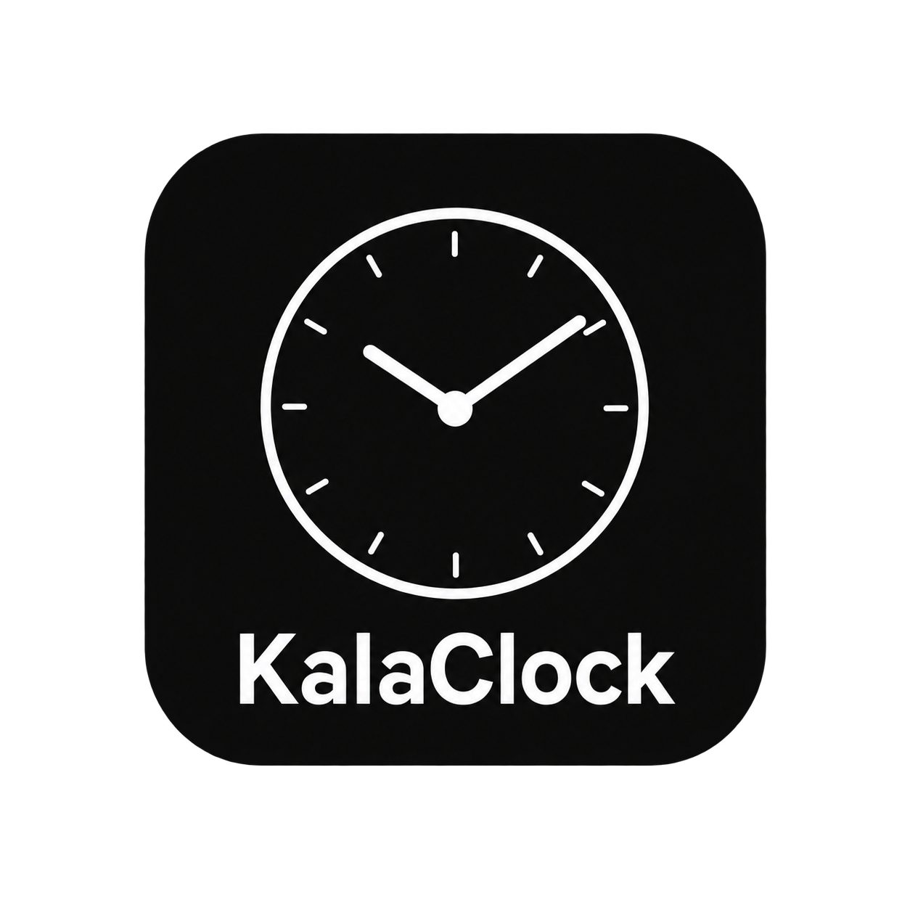

# KalaClock

<p align="center"></p>

A flip clock for Android and iOS, built for leaving on a desk all night. "Kala" means "time" in Sanskrit and Indonesian.

Two big split-flap cards show the hour and the minute, with the date, weekday and AM/PM printed on the cards. The background is pure black so OLED pixels stay off.

## Features

- **Flip clock**: animated flip cards, 12/24h, AM/PM, date, weekday, battery indicator.
- **Stopwatch, countdown and Pomodoro**: focus 25 / break 5 / long break 15 after 4 sessions, all configurable. Time is derived from monotonic timestamps, not tick counting, so it does not drift. On Android, Do Not Disturb turns on during a Pomodoro focus phase and goes back to its previous setting afterwards.
- **Portrait and landscape**: cards stack in portrait and sit side by side in landscape. The orientation follows the sensor even when the system rotation lock is on.
- **OLED friendly**: pure `#000000` background, optional card-less mode (digits only), auto dim after 15 seconds without touch, and an optional pixel shift that is off by default.
- **Now playing**: artist, title and artwork (grayscale and dimmed), when the platform allows it.
- **Settings**: card style, brightness, 24h, date, battery, now playing, Pomodoro durations. Changes are saved explicitly, and closing with unsaved changes asks whether to save.
- Fullscreen, keeps the screen on, and the mode bar hides itself so the clock re-centers.

## Repository layout

```
android/              Kotlin + Jetpack Compose app (Gradle)
ios/                  SwiftUI app (Xcode project generated by XcodeGen)
icon-kalaclock.png    Source artwork for the app icon
PLAN.md               Original plan and milestones
```

Both apps share the same design and behavior, written natively for each platform. They do not share code.

## Android

Requirements: JDK 17, Android SDK 36. `minSdk` 26.

```sh
cd android
./gradlew :app:testDebugUnitTest   # timer engine unit tests
./gradlew :app:assembleDebug       # debug APK
```

Or open `android/` in Android Studio and run the `app` configuration.

Stack: Kotlin, Jetpack Compose (Material 3), DataStore for settings, a foreground service plus `AlarmManager` (`USE_EXACT_ALARM`) for timers, and a `NotificationListenerService` for now playing.

### Now playing setup

Grant Notification access to KalaClock once (Settings has a button that opens the right page). Artwork depends on the player: some only expose an image URI, which the app loads, and some expose nothing, in which case only the text is shown.

### Battery optimization

Some vendors (Xiaomi, Oppo and others) kill background services. If a running timer stops when the screen is off, exclude KalaClock from battery optimization.

## iOS

Requirements: Xcode 26 or newer, iOS 16+. [XcodeGen](https://github.com/yonaskolb/XcodeGen) is only needed to regenerate the project.

```sh
cd ios
open KalaClock.xcodeproj           # run the KalaClock scheme
xcodegen generate                  # after editing project.yml
```

Tests: `KalaClockTests` (timer engine), run with Cmd+U.

### Differences from Android

- The timer finish alert is a local notification, because iOS has no foreground service. Time is still computed from monotonic timestamps.
- Now playing reads Apple Music only. iOS does not let apps read other players such as Spotify or YouTube Music.
- Brightness is system-wide on iOS, so auto dim restores the original brightness when the app leaves the foreground.
- iOS does not let apps change Focus or Do Not Disturb, so the Pomodoro Do Not Disturb feature is Android only. You can create a Focus in iOS Settings and start it yourself.
- There is no system back button, so back-to-clock is not ported.

## Privacy and security

KalaClock works fully offline. It has no network permission, no analytics, no accounts and no credentials, and it does not write logs. Settings stay on the device.

Android permissions and why they exist:

- `POST_NOTIFICATIONS`, `FOREGROUND_SERVICE`, `USE_EXACT_ALARM`, `WAKE_LOCK`: the timer notification and the finish alarm.
- Notification access (granted by the user in Settings): now playing and the message/email icons. Only the media title, artist and artwork, plus the package name and category of notifications, are read. Notification text is never read.
- Do Not Disturb access (granted by the user): switching Do Not Disturb on during Pomodoro focus and restoring the previous mode afterwards. Alarms and the finish alert still come through.
- Device admin with the `force-lock` policy only (granted by the user): locking the phone after idle. It cannot wipe data or change passwords.

Only the launcher activity is exported. The device admin receiver and the notification listener are exported because Android requires it, and both are protected by system-only permissions. Backup is disabled. On iOS the app uses no network and only reads Apple Music's now playing item after you allow it.

Never commit `android/keystore.properties` or a keystore file; both are git-ignored.

## App icon

The source artwork is `icon-kalaclock.png` in the repo root. The platform icons are derived from it:

- **iOS**: `ios/KalaClock/Assets.xcassets/AppIcon.appiconset/AppIcon.png`, 1024x1024 with no transparency.
- **Android**: adaptive icon in `android/app/src/main/res/` (`mipmap-anydpi-v26/ic_launcher.xml`, solid `#0C0C0B` background, `drawable-nodpi/ic_launcher_foreground.png` scaled to fit the safe zone).

To change the icon, regenerate those files from the source artwork. The system rounds the corners, so the platform files are full-bleed squares.

## Fonts

Digits and labels use [Roboto Condensed](https://github.com/googlefonts/roboto-3-classic) (Bold and SemiBold), bundled in both apps under the Apache License 2.0.

## Status

Android is feature complete for the first version. iOS is a full port and has been checked in the simulator in portrait. Landscape, the timer screens and now playing on iOS still need a pass on real devices.
